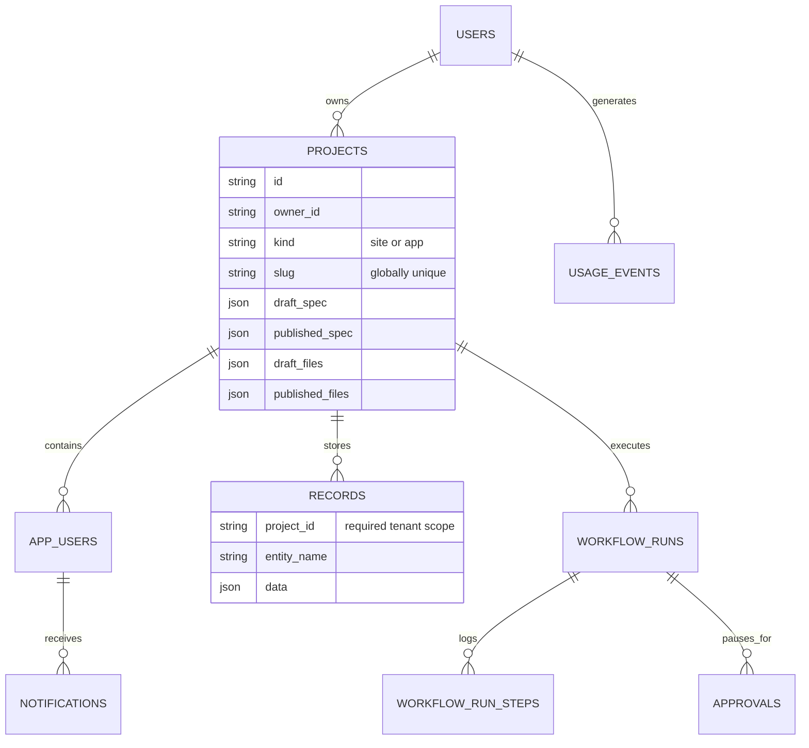
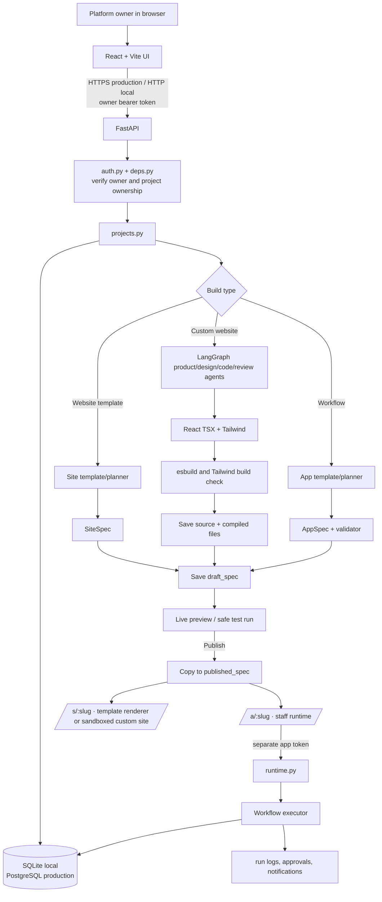

# Sequence — Codebase and Request Architecture

This is the current codebase architecture: its local stack, how browser
actions reach the database/runtime, and how the two AI build paths stay separate.

## Stack

| Layer | Current technology | Role |
|---|---|---|
| Web client | React 19, Vite 7, React Router, Tailwind | Landing, shared workspace, builders and public renderers |
| API | Python, FastAPI, Pydantic | Auth, validation, builder APIs, runtime APIs and planning |
| ORM/database | SQLAlchemy 2 + SQLite locally | Users, projects, specs, records, runs, approvals and logs |
| Production database | PostgreSQL | Intended replacement for SQLite; models are portable |
| Authentication | Signed bearer tokens + password hashes | Owner token and separate, per-app staff token |
| AI provider seam | `app/ai/provider.py` | Groq, Gemini and Anthropic with provider failover; templates remain available without keys |
| Custom website agents | `app/ai/site_agents.py` | LangGraph planner, designer, React builder, reviewer and build verifier |
| Runtime | Python workflow executor | Runs validated workflow specs and records every step |

Locally, React is served from `http://localhost:5173` and FastAPI from
`http://localhost:8000`. `VITE_API_URL` chooses the API address and FastAPI
CORS permits the local web origin. This is HTTP-only local development.

In production, web and API hosting must terminate HTTPS (for example at
Vercel/Render or another reverse proxy). The browser then calls
`https://api.your-domain/...` over TLS. TLS certificates, HTTP redirects and
HSTS belong at that hosting/proxy layer; FastAPI receives traffic behind the
trusted proxy. SQLite must be replaced with a managed PostgreSQL URL and
Alembic migrations before production.

## Codebase map

```text
apps/
├── web/                                      React/Vite frontend
│   └── src/
│       ├── pages/
│       │   ├── Landing, SignIn, Dashboard    public + platform-owner UI
│       │   ├── NewSite, SiteBuilder          website template flow
│       │   ├── NewApp, Builder               workflow plan/test/team/history flow
│       │   ├── PublishedSite                  public site: /s/:slug
│       │   └── runtime/PublishedApp           staff app: /a/:slug
│       ├── components/SiteCanvas.jsx          safe five-template SiteSpec renderer
│       └── lib/api.js                         HTTP client + token separation
│
└── api/app/                                  FastAPI service
    ├── main.py                               app, CORS, lifespan, routers
    ├── config.py                             environment and provider selection
    ├── db.py + models.py                     SQLAlchemy engine/session/tables
    ├── security.py + deps.py                 tokens and server authorization
    ├── routers/auth.py                       platform owner authentication
    ├── routers/projects.py                   plans, drafts, templates, publish
    ├── routers/runtime.py                    staff login, forms, approvals, sites
    ├── specs/                                SiteSpec/AppSpec, catalog, validator
    ├── sites/templates.py                    permitted site templates/themes
    ├── ai/                                   provider interface, prompts, planner
    ├── engine/                               executor, expressions and step handlers
    ├── runtime/                              tenant-scoped records/field coercion
    └── demos/                                leave, expense and complaint templates
```

## Data model and isolation

FastAPI opens a SQLAlchemy session per request. Locally `DATABASE_URL` points
at `apps/api/local.db`; during development the API creates tables on startup.
Production uses the same models against PostgreSQL, but migrations replace
automatic table creation.



`Project` is shared by both builders. `kind = site` holds a `SiteSpec`;
`kind = app` holds an `AppSpec`. Publish freezes a draft by copying it to
`published_spec` and any custom-site build files. Custom site source snapshots
live in `site_revisions` and can be restored as a new draft. `RecordStore`
requires `project_id`, so record reads and writes are server-side tenant scoped.

## Complete system flow



## A. Website click-by-click flow

```mermaid
sequenceDiagram
    actor Owner
    participant UI as React: Dashboard/NewSite
    participant API as FastAPI projects router
    participant Agents as LangGraph site agents
    participant DB as SQLite/Postgres
    participant Render as Template renderer or sandbox iframe

    Owner->>UI: Choose a starter template or custom AI site
    alt Template path
        UI->>API: POST /api/projects with SiteSpec
    else Custom AI site
        UI->>API: POST /api/plan/site/custom
        API->>Agents: Planner → designer → React builder → reviewer
        Agents->>Agents: esbuild + Tailwind compile; one repair attempt
        Agents-->>API: Valid SiteSpec and checked TSX/CSS
        UI->>API: POST /api/projects with source files
    end
    API->>DB: Save project and source revision
    API-->>UI: Project id, editable files and /s/slug
    UI->>Render: Show isolated preview and code editor
    Owner->>UI: Save, restore a version, or publish
    UI->>API: PATCH project; POST /publish
    API->>DB: Freeze spec and compiled assets
    Render->>API: Visitor opens /s/slug; GET /api/s/slug
    API->>DB: Read published snapshot
```

The starter library has 20 directions. Template sites render trusted React
markup from a `SiteSpec`; custom sites render their compiled React bundle only
inside an opaque-origin iframe with a restrictive Content Security Policy.

## B. Workflow click-by-click flow

```mermaid
sequenceDiagram
    actor Owner
    actor Staff
    participant UI as React builder/runtime
    participant API as FastAPI
    participant Plan as Planner + validator
    participant DB as SQLite/Postgres
    participant Engine as Workflow executor

    Owner->>UI: Choose custom workflow or a template
    alt Built-in template
        UI->>API: POST /api/projects/from-template
    else Custom workflow
        UI->>API: POST /api/plan/app
        API->>Plan: Request strict JSON; retry once if invalid
        Plan-->>API: AppSpec only after catalog and cross-reference validation
        API-->>UI: Plain-language plan and valid AppSpec, or provider/validation error
    end
    Owner->>UI: Build, test, invite staff and publish
    UI->>API: Create project / test-run / publish
    API->>DB: Draft/frozen spec, memberships and history
    Staff->>UI: Open /a/slug and sign in
    UI->>API: Runtime request with app-only bearer token
    API->>Engine: Start run from form submission
    Engine->>DB: Records and step log; pause when approval is needed
    Staff->>UI: Approve or reject
    UI->>API: POST approval decision
    API->>Engine: Resume persisted cursor + workflow snapshot
    Engine->>DB: Completed run and notifications
```

## AI providers and custom website graph

Templates and the workflow runtime remain available without API keys. Custom
workflow and custom website generation require a configured AI provider. Groq,
Gemini and Anthropic can be configured; requests try configured providers in
order and fall back between providers. This is provider failover, not cycling
multiple keys to evade a single provider’s quotas.

Workflow planning still returns an `AppSpec`, validates every reference and
never executes model-written JavaScript, shell commands or SQL. Custom websites
are a separate fixed-stack path. LangGraph nodes plan product content, design
the layout, write React TSX and CSS, review the result, and compile it with
fixed local esbuild/Tailwind binaries. Generated code does not execute during
compilation. On a build error, one repair attempt runs before the build fails.

Custom source and compiled assets are stored in SQL JSON columns; `site_revisions`
keeps versioned snapshots. MongoDB is not needed for this project-file scale.
The browser preview uses an iframe without `allow-same-origin`, no app storage,
no form submission, and CSP network access restricted to image hosts. Before
public launch, move compilation from the API process into a dedicated worker
container with resource limits. The PostgreSQL schema update is in
`apps/api/migrations/0002_custom_sites.sql`.

## Security boundaries to preserve

- Platform-owner tokens can access builder/project routes only.
- App-user tokens are separate and restricted to one app and role; runtime
  permissions are rechecked on the API for every action.
- Ownership and `project_id` record scoping are server enforced, not frontend
  button visibility.
- Public template sites read frozen `SiteSpec`; custom sites read frozen compiled files and run inside a sandboxed iframe.
- Do not add `allow-same-origin` or loosen the CSP on custom-site preview iframes.
- A workflow run holds its starting spec snapshot, so draft edits cannot alter
  an approval that is paused in progress.
