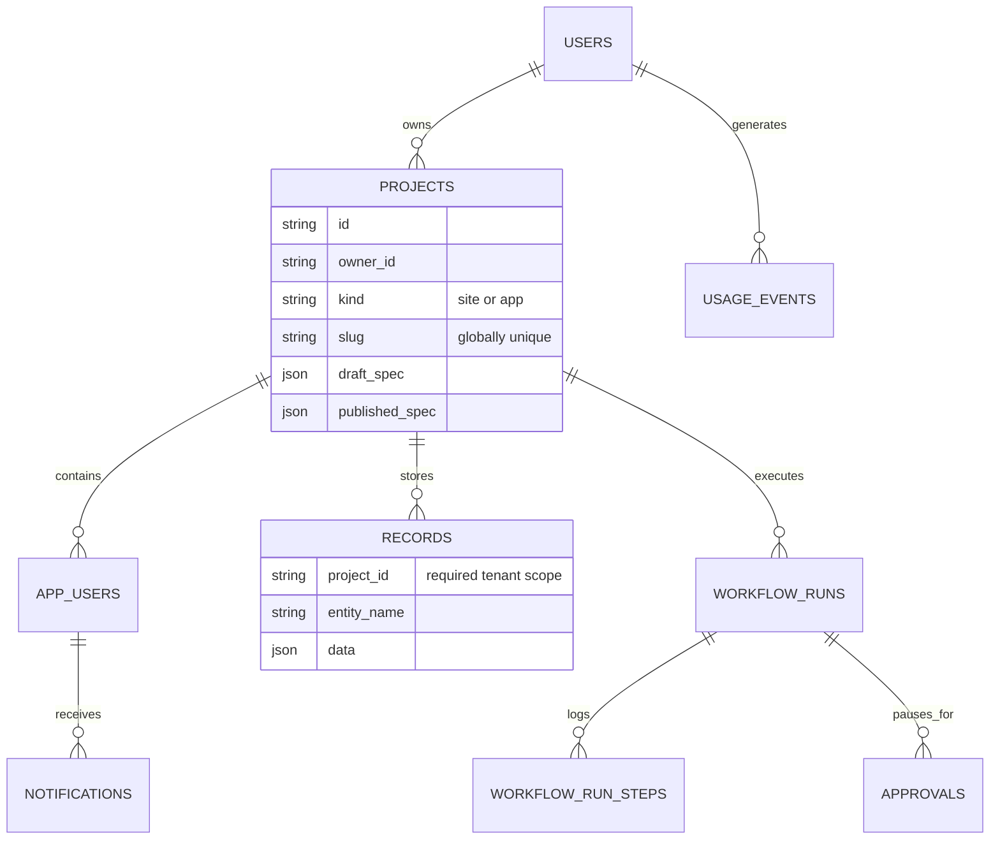
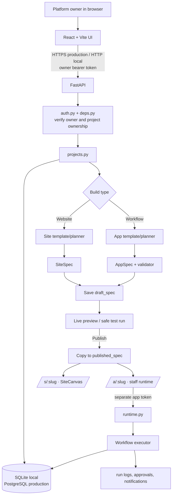
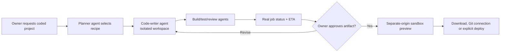

# Sequence — Codebase and Request Architecture

This is the current codebase architecture: its local stack, how browser
actions reach the database/runtime, and where future LLM code writing fits.

## Stack

| Layer | Current technology | Role |
|---|---|---|
| Web client | React 19, Vite 7, React Router, Tailwind | Landing, shared workspace, builders and public renderers |
| API | Python, FastAPI, Pydantic | Auth, validation, builder APIs, runtime APIs and planning |
| ORM/database | SQLAlchemy 2 + SQLite locally | Users, projects, specs, records, runs, approvals and logs |
| Production database | PostgreSQL | Intended replacement for SQLite; models are portable |
| Authentication | Signed bearer tokens + password hashes | Owner token and separate, per-app staff token |
| AI provider seam | `app/ai/provider.py` | Anthropic/Groq if configured; template fallback without any key |
| Runtime | Python workflow executor | Runs validated workflow specs and records every step |

Locally, React is served from `http://localhost:5173` and FastAPI from
`http://localhost:8000`. `VITE_API_URL` chooses the API address and FastAPI
CORS permits the local web origin. This is HTTP-only local development.

In production, web and API hosting must terminate HTTPS (for example at
Vercel/Render or another reverse proxy). The browser then calls
`https://api.your-domain/...` over TLS. TLS certificates, HTTP redirects and
HSTS belong at that hosting/proxy layer; FastAPI receives traffic behind the
trusted proxy. SQLite must be replaced with a managed PostgreSQL URL and
Alembic migrations before production.

## Codebase map

```text
apps/
├── web/                                      React/Vite frontend
│   └── src/
│       ├── pages/
│       │   ├── Landing, SignIn, Dashboard    public + platform-owner UI
│       │   ├── NewSite, SiteBuilder          website template flow
│       │   ├── NewApp, Builder               workflow plan/test/team/history flow
│       │   ├── PublishedSite                  public site: /s/:slug
│       │   └── runtime/PublishedApp           staff app: /a/:slug
│       ├── components/SiteCanvas.jsx          safe five-template SiteSpec renderer
│       └── lib/api.js                         HTTP client + token separation
│
└── api/app/                                  FastAPI service
    ├── main.py                               app, CORS, lifespan, routers
    ├── config.py                             environment and provider selection
    ├── db.py + models.py                     SQLAlchemy engine/session/tables
    ├── security.py + deps.py                 tokens and server authorization
    ├── routers/auth.py                       platform owner authentication
    ├── routers/projects.py                   plans, drafts, templates, publish
    ├── routers/runtime.py                    staff login, forms, approvals, sites
    ├── specs/                                SiteSpec/AppSpec, catalog, validator
    ├── sites/templates.py                    permitted site templates/themes
    ├── ai/                                   provider interface, prompts, planner
    ├── engine/                               executor, expressions and step handlers
    ├── runtime/                              tenant-scoped records/field coercion
    └── demos/                                leave, expense and complaint templates
```

## Data model and isolation

FastAPI opens a SQLAlchemy session per request. Locally `DATABASE_URL` points
at `apps/api/local.db`; during development the API creates tables on startup.
Production uses the same models against PostgreSQL, but migrations replace
automatic table creation.



`Project` is shared by both builders. `kind = site` holds a `SiteSpec`;
`kind = app` holds an `AppSpec`. Publish freezes a draft by copying it to
`published_spec`. `RecordStore` requires `project_id`, so record reads and
writes are server-side tenant scoped.

## Complete system flow



## A. Website click-by-click flow

```mermaid
sequenceDiagram
    actor Owner
    participant UI as React: Dashboard/NewSite
    participant API as FastAPI projects router
    participant DB as SQLite/Postgres
    participant Render as SiteCanvas

    Owner->>UI: Click New website and choose a template
    Owner->>UI: Enter a name and optional description
    alt Template-first / no AI key
        UI->>API: POST /api/projects with SiteSpec
    else AI key configured and description given
        UI->>API: POST /api/plan/site
        API-->>UI: Valid SiteSpec (or Echo fallback)
        UI->>API: POST /api/projects with SiteSpec
    end
    API->>DB: Insert draft Project
    API-->>UI: Project id and /s/slug
    UI->>Render: Render editable spec preview
    Owner->>UI: Save and click Publish
    UI->>API: PATCH project; POST /publish
    API->>DB: Freeze published_spec
    Render->>API: Visitor opens /s/slug; GET /api/s/slug
    API->>DB: Read published SiteSpec only
```

The five supported renderers are Portfolio, Freelancer, Local Business, Event
and Personal. They render trusted React markup from `SiteSpec` data, never
user-provided HTML or JavaScript.

## B. Workflow click-by-click flow

```mermaid
sequenceDiagram
    actor Owner
    actor Staff
    participant UI as React builder/runtime
    participant API as FastAPI
    participant Plan as Planner + validator
    participant DB as SQLite/Postgres
    participant Engine as Workflow executor

    Owner->>UI: Choose New workflow or a demo template
    UI->>API: POST /api/plan/app
    API->>Plan: Request strict JSON; retry once if invalid
    alt no key / provider unavailable
        Plan-->>API: Closest built-in workflow template
    else valid provider result
        Plan-->>API: AppSpec
    end
    Plan-->>API: Catalog + cross-reference validation passes
    API-->>UI: Plain-language plan and valid AppSpec
    Owner->>UI: Build, test, invite staff and publish
    UI->>API: Create project / test-run / publish
    API->>DB: Draft/frozen spec, memberships and history
    Staff->>UI: Open /a/slug and sign in
    UI->>API: Runtime request with app-only bearer token
    API->>Engine: Start run from form submission
    Engine->>DB: Records and step log; pause when approval is needed
    Staff->>UI: Approve or reject
    UI->>API: POST approval decision
    API->>Engine: Resume persisted cursor + workflow snapshot
    Engine->>DB: Completed run and notifications
```

## AI availability and pending code-writing path

No API key is required for the current experience. When neither
`ANTHROPIC_API_KEY` nor `GROQ_API_KEY` exists, configuration resolves to
`EchoProvider`: workflow prompts choose the closest JSON demo template and
website prompts return a basic `SiteSpec`. Preview, test and publishing stay
fully available.

With an AI key, the planner asks for strict JSON, parses it through Pydantic,
validates it, and retries once with the error feedback. It never executes
model-written JavaScript, shell commands or SQL.

Actual code writing is a **pending third project type**, not a replacement for
the safe template/runtime path:



The eventual ETA must be computed from queued-job and step progress, never
invented in the UI. Until that worker system exists, call it **Coming soon**.
Generated code must use separate containers/origins, restricted filesystems,
package allowlists, command timeouts, no platform secrets, build logs and an
explicit deployment approval.

## Security boundaries to preserve

- Platform-owner tokens can access builder/project routes only.
- App-user tokens are separate and restricted to one app and role; runtime
  permissions are rechecked on the API for every action.
- Ownership and `project_id` record scoping are server enforced, not frontend
  button visibility.
- Public sites read frozen `SiteSpec` data only and do not host arbitrary code.
- A workflow run holds its starting spec snapshot, so draft edits cannot alter
  an approval that is paused in progress.
